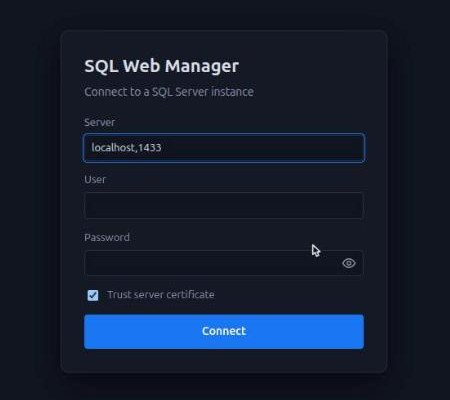
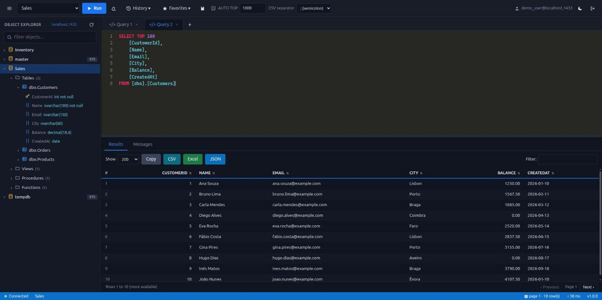
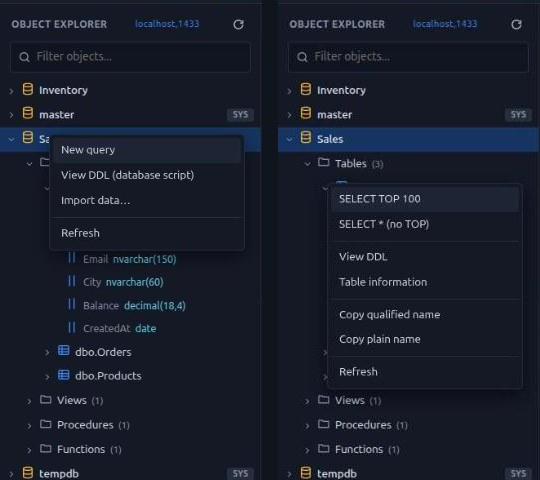
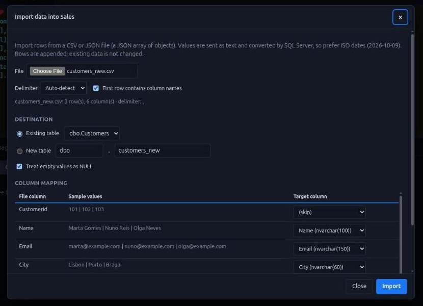
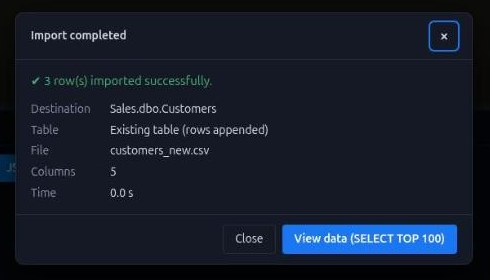

# SQL Web Manager

A web client for SQL Server (SSMS-style) built with plain PHP, HTML, CSS and JavaScript, with no front-end dependencies and no Composer.

## Documentation

The full documentation is in [`docs/`](docs/README.md): [user manual](docs/user-guide.md), [configuration and operations](docs/configuration.md), [security](docs/security.md), [API reference](docs/api.md), [architecture](docs/architecture.md), [development guide](docs/development.md) and [decisions (ADRs)](docs/adr/README.md). History is in [CHANGELOG.md](CHANGELOG.md).

## Features

### Connection and security
- Sign in with SQL Server authentication (server, user and password); the server accepts `host`, `host\instance`, `host,port` or `host:port`, and an optional allowlist (`allowed_servers`) stops the app from being used as a network proxy
- The password stays in the server-side PHP session and is never sent to the browser; `HttpOnly`/`SameSite=Strict` cookie, CSRF token on every POST, idle session timeout and security headers
- Show/hide button on the password field; server pre-filled with `localhost,1433` (configurable)

### Object Explorer
- Every database on the server (system databases marked `SYS`), each with Tables, Views, Procedures and Functions; objects and columns load on demand, with a filter and per-node refresh
- Context menu (right click) on databases, tables, views, procedures and functions:
  - **Tables and views:** `SELECT TOP 100` (opens a new tab listing every column and runs it), `SELECT *` without TOP (asks for confirmation first if the table has more than 100,000 rows), **View DDL**, **Table information** (approximate rows, space, indexes and foreign keys), copy qualified or plain name, **Refresh**
  - **Databases:** new query (`USE [database]`), database DDL (collation and options), **Import data…**, refresh
  - **Procedures and functions:** view DDL (definition), copy name, refresh
- Double-click a table to run `SELECT TOP`; click a column to insert its name into the editor

### Editor and execution
- SQL editor with syntax highlighting, line numbers and multiple tabs (saved in the browser)
- Runs the selected text or the whole script with `F5` or `Ctrl+Enter`; supports `GO` batches and multiple result sets
- **Messages** tab with `PRINT` output, rows affected, errors and timing
- AUTO TOP, query history (last 50), favorites, save as `.sql`, light/dark theme

### Results grid and pagination
- Sorting, filtering and a selectable page size; `NULL`, numeric and binary values are shown clearly
- **Server-side pagination** (200 rows per page, `OFFSET/FETCH`) for a single `SELECT`, so neither the server nor the browser loads the whole result at once
- Exact decimals (`decimal`, `numeric`, `money`) shown in the SQL standard, with a dot and at least two decimal places

### Export
- Copy, **CSV**, **Excel** (a real `.xlsx` built in the browser, with no dependencies) and **JSON**
- For paginated results the export re-runs the query and returns the **complete result**, streamed by the server
- Selectable CSV separator (`;`, `,`, tab or `|`) in the top bar, next to AUTO TOP
- Files named `schema.table_ddMMyyyy.ext`

### Import
- **Import data…** (right-click a database): load a **CSV** or **JSON** file into an existing table (with column mapping) or a new one (types inferred and editable)
- Delimiter auto-detection, quoted CSV cells, empty values as `NULL`, progress bar, atomic batches with resume, and a summary window when it finishes

### Deployment
- Docker image (PHP 8.3, Apache, ODBC Driver 18, `pdo_sqlsrv`) with an optional demo SQL Server; also runs on Apache, Nginx and IIS, including with the whole project in a single folder
- No Composer and no front-end build: plain PHP, HTML, CSS and JavaScript

## Screenshots

The screenshots below use demo data.

**Sign in** — server pre-filled, with a show/hide button on the password field:



**Editor and results** — `SELECT TOP 100` lists every column; the grid is paginated on the server (200 rows per page) and exact decimals are shown with two decimal places. Export buttons (Copy, CSV, Excel, JSON) sit above the grid, and the CSV separator is in the top bar:



**Object Explorer context menus** — database menu (left, with **Import data…**) and table menu (right):



**Import data** — load a CSV or JSON file into an existing table, with automatic column mapping:



**Import completed** — summary window shown at the end of an import:



## Requirements

- PHP 8.2+ with the `pdo_sqlsrv` and `sqlsrv` extensions
- Microsoft ODBC Driver 17/18 for SQL Server

## Running

### Docker (recommended)

```bash
docker compose up -d
```

Opens at http://localhost:8080 (change the port with `SQLWM_PORT`). The image ships PHP 8.3, Apache, ODBC Driver 18 and `pdo_sqlsrv`; an uncached build takes about 1.5 minutes.

To try it without a SQL Server at hand, also start the demo one and use server `mssql`, user `sa`:

```bash
docker compose --profile demo up -d
```

First, set `MSSQL_SA_PASSWORD` (a strong password of your own) in the `.env` file, which is not versioned: the compose file ships no default password and SQL Server will not start without one. The demo SQL Server port is not published. Driver 18 encrypts connections by default; with a self-signed certificate, check "Trust server certificate" on the login screen.

### Local PHP

```bash
php -S localhost:8080 -t public
```

On Apache/Nginx, point the document root at `public/` (a `.htaccess` file handles the rewrite to the front controller).

### IIS, with the whole project in one folder (not pointing at `public/`)

Copy the whole project into the site folder and use the `index.php` in the project root. Paste the contents of `deploy/iis-rewrite.xml` inside `<system.webServer>` in `web.config` (requires the URL Rewrite module): `assets/` is served from `public/assets/` and everything else goes to `index.php`, so `app/`, `config/` and `tests/` are not exposed. The site's PHP must be 8.2+ with `pdo_sqlsrv`, and the session folder (`session.save_path`) must be writable.

## Tests

```bash
php tests/run.php
node tests/xlsx.test.js
node tests/import.test.js
```

They cover the pure functions, the value objects and the `.xlsx` generator; neither needs a database.

## Architecture

MVC with a front controller. The code combines three styles, each where it pays off most:

| Style | Where | Examples |
|---|---|---|
| **OO** | Layers with state or side effects | `Request`/`Response` (immutable), `Session`, `Router`, `Container`, `CatalogRepository`, `QueryExecutor`, controllers |
| **Functional** | Domain rules and composition | `app/Models/functions.php` and `ddl.php` (pure functions, including DDL generation), `Result` (Either), `pipe`, `take`, middleware via `pipeline` |
| **MVC** | Request flow | Router → middleware → Controller → Model → View |

```
public/            document root: index.php (front controller) and assets/
app/
  Core/            Application (composition root), Router, Container, View, Config
  Http/            Request, Response, Session, Middleware
  Controllers/     Auth, Editor, Explorer (catalog), Query (execution) — thin, orchestration only
  Models/          Connection, ConnectionFactory, CatalogRepository, QueryExecutor, QueryResult
                   functions.php: pure rules (split_batches, normalize_server, type_label...)
  Views/           layout, login, editor (PHP templates; output always escaped with $e())
  Support/         Result and generic functions (pipe, partial, take, pipeline, e)
  routes.php       routes declared as data
config/            config.php (defaults) and config.local.php (yours, not versioned)
tests/             run.php
Dockerfile, docker-compose.yml, docker/    packaging (Apache + ODBC 18 + pdo_sqlsrv)
```

Decisions:
- **Immutability:** `Request`, `Response`, `Connection` and `QueryResult` are `readonly`; "changing" one returns a new instance.
- **Expected errors are values, not exceptions:** login validation returns a `Result`, chained with `flatMap`. Exceptions are reserved for unexpected failures (handled in `Application`, without leaking details).
- **Pure core, impure edge:** only `ConnectionFactory`, `CatalogRepository`, `QueryExecutor` and `Session` do I/O. Everything else is deterministic and testable.
- **No magic autowiring:** dependencies are wired explicitly in `Application::container()`.

## Configuration

Precedence: `config/config.php` < `config/config.local.php` < environment variables. To override values in a file, create `config/config.local.php`:

```php
<?php
return [
    'default_server'  => 'myserver:1433',
    'allowed_servers' => ['myserver:1433'],
    'max_rows'        => 5000,
];
```

Environment variables (handy with Docker; empty values are ignored — see `.env.example`): `SQLWM_DEFAULT_SERVER`, `SQLWM_ALLOWED_SERVERS` (comma-separated list), `SQLWM_ENCRYPT`, `SQLWM_TRUST_SERVER_CERTIFICATE`, `SQLWM_MAX_ROWS`, `SQLWM_EXPORT_MAX_ROWS`, `SQLWM_CSV_SEPARATOR`, `SQLWM_QUERY_TIMEOUT`, `SQLWM_SESSION_TIMEOUT`.

## Security

This tool runs arbitrary SQL with the credentials of the logged-in user.

- Use HTTPS in any environment other than localhost.
- Fill in `allowed_servers` to stop the application from being used as a proxy to other hosts.
- Give the SQL Server login only the permissions it needs; the application does not enforce a read-only mode.
- The password lives in the PHP session, on the server, and is never sent to the browser. The cookie is `HttpOnly` and `SameSite=Strict`, and every POST requires a CSRF token.
- Only `public/` is exposed: code, configuration and templates stay outside the document root.
- The session expires after `session_timeout` seconds of inactivity.

## License

Released under the [MIT License](LICENSE).
