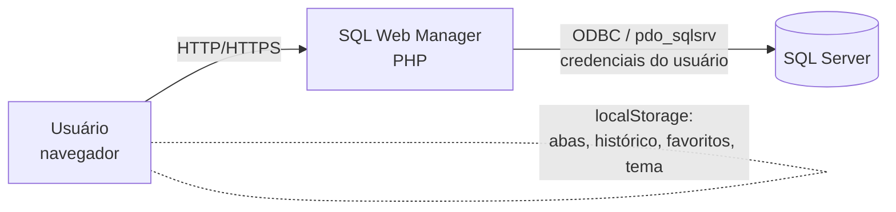
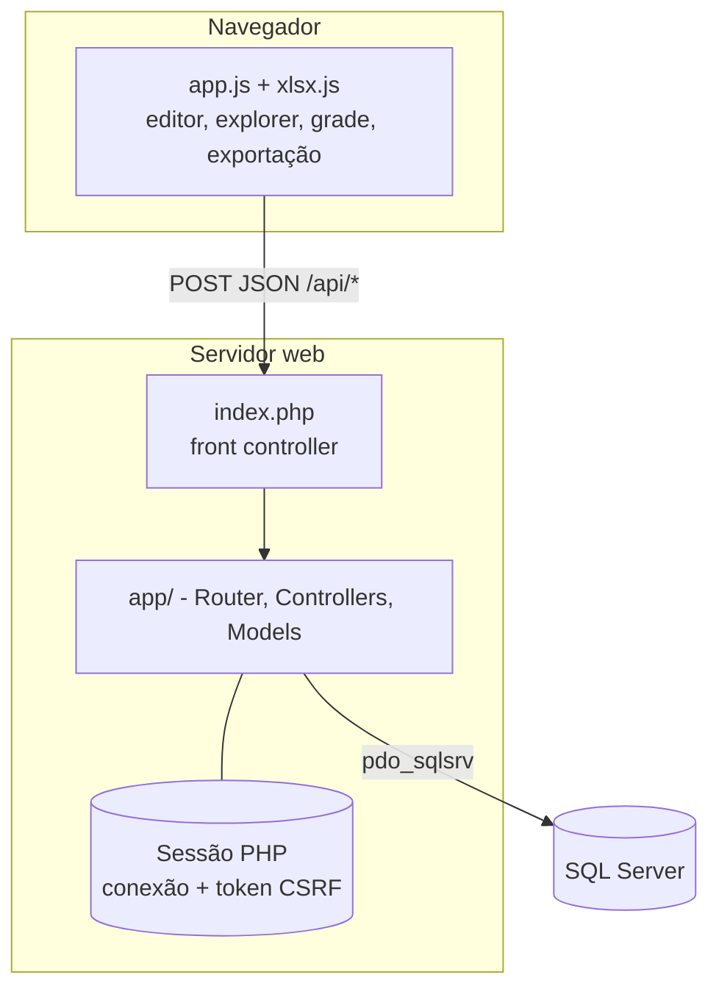
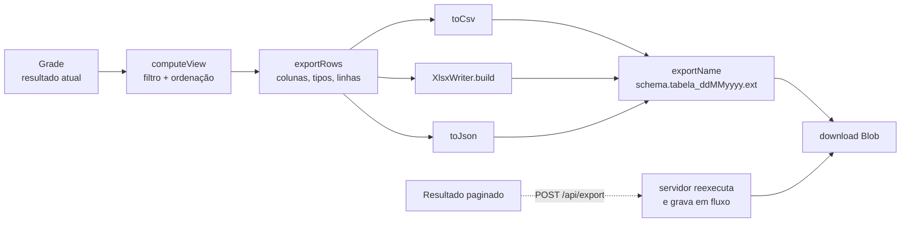

# Arquitetura

Aplicação PHP em MVC com um front controller, sem Composer. O front-end é JavaScript puro, servido como arquivos estáticos. O servidor **não guarda dados de negócio**: abre uma conexão nova com o SQL Server a cada requisição, usando as credenciais que ficam na sessão PHP.

## Contexto (C4, nível 1)



## Contêineres (C4, nível 2)



## Ciclo de uma requisição

```mermaid
sequenceDiagram
    participant B as Navegador
    participant I as index.php
    participant A as Application
    participant R as Router
    participant M as Middlewares
    participant C as Controller
    participant D as SQL Server
    B->>I: POST /api/execute (JSON + X-CSRF-Token)
    I->>A: Request::fromGlobals()
    A->>A: Session::start (timeout por inatividade)
    A->>R: dispatch(request)
    R->>M: auth.api → csrf
    M->>C: QueryController::execute
    C->>C: Session::release() (libera o lock da sessão)
    C->>D: QueryExecutor (conexão nova, USE banco, lotes; com "page", OFFSET/FETCH)
    D-->>C: result sets e mensagens
    C-->>B: Response::json + cabeçalhos de segurança
```

Detalhes:

- `Application::handle` captura qualquer `Throwable`, grava no `error_log` e devolve erro genérico (500) sem vazar detalhes.
- Os cabeçalhos `X-Content-Type-Options`, `X-Frame-Options` e `Referrer-Policy` são aplicados a **toda** resposta, inclusive erros.
- Controllers que falam com o banco chamam `Session::release()` logo depois de ler a conexão, para que consultas longas não bloqueiem outras requisições do mesmo usuário (o PHP trava o arquivo de sessão enquanto está aberta).

## Estrutura de pastas

```
index.php           entrada para hospedagens sem acesso a public/ (inclui public/index.php)
public/             document root: index.php (front controller) e assets/ (css, js)
app/
  bootstrap.php     autoload PSR-4 (App\ → app/) + funções livres; devolve a Config
  routes.php        rotas como dados
  Core/             Application (composition root), Router, Container, View, Config
  Http/             Request, Response, Session, Middleware
  Controllers/      Auth, Editor, Explorer, Query — finos, só orquestram
  Models/           Connection, ConnectionFactory, CatalogRepository, ObjectScripter,
                    QueryExecutor, QueryResult; functions.php e ddl.php (funções puras)
  Views/            layout, login, editor (templates PHP)
  Support/          Result e funções genéricas (pipe, partial, take, pipeline, e)
config/             config.php (padrões) e config.local.php (seu, não versionado)
deploy/             iis-rewrite.xml (trecho de web.config)
docker/             apache.conf e php.ini da imagem
tests/              run.php (PHP) e xlsx.test.js (Node)
docs/               esta documentação
```

## Camadas e responsabilidades

| Componente | Papel |
|---|---|
| `Application` | Composition root: liga as dependências em `container()`, inicia a sessão, despacha e aplica cabeçalhos |
| `Router` | Casa método + caminho exato (sem parâmetros na URL), monta a cadeia de middlewares com `pipeline` e chama a ação do controller. 404 para caminho desconhecido; 405 com `Allow` para método errado |
| `Middleware` | `auth.page` (redireciona), `auth.api` (401), `guest`, `csrf` |
| `Session` | Encapsula `$_SESSION`. Guarda a conexão (incluindo a senha, no servidor) e o token CSRF; expira por inatividade |
| `ConnectionFactory` | **Único** ponto que abre `PDO`. O banco é escolhido com `USE [banco]` e não no DSN |
| `CatalogRepository` | Consulta o catálogo (`sys.*`): bancos, objetos, colunas, índices, chaves estrangeiras, espaço |
| `ObjectScripter` | Gera DDL de tabelas, views, procedures, funções e bancos |
| `QueryExecutor` | Divide por `GO`, executa lote a lote, lê result sets (limite + 1 linha para detectar truncamento) e mensagens (`PRINT`, linhas afetadas) |
| `QueryResult` | Valor imutável com sets, mensagens, erro e tempo |

### Funções puras (`app/Models/functions.php`, `ddl.php`)

Sem I/O nem estado: ficam cobertas pelos testes sem precisar de banco. Principais: `quote_identifier`, `normalize_server`, `ensure_server_allowed`, `build_dsn`, `split_batches`, `effective_limit`, `type_label`, `column_view`, `database_view`, `safe_cell`, `column_descriptor`, `clean_error_message`, `pdo_error`, `group_indexes`, `group_foreign_keys`, `space_view`, `build_create_table`, `build_create_database`.

## Front-end

Arquivos estáticos sem build:

- `public/assets/js/app.js`: tudo da interface (editor com realce e numeração, abas, Object Explorer, menu de contexto, grade, exportação, histórico e favoritos). Fala com o servidor só por `POST /api/*` (`api()` envia o `X-CSRF-Token`; resposta 401 leva ao login).
- `public/assets/js/xlsx.js`: gerador de `.xlsx` sem dependências. Um `.xlsx` é um ZIP de XMLs; o ZIP é escrito com o método *stored* (sem compressão), com CRC-32 calculado em JS. Expõe `XlsxWriter.build(columns, types, rows)` (Blob, no navegador) e `buildBytes(...)` (bytes, usado em Node nos testes).
- `public/assets/css/app.css`: tema claro/escuro (atributo `data-theme`).
- Estado local (`localStorage`, prefixo `sqlwm.`): `tabs`, `activeTab`, `history`, `favorites`, `db`, `autoTop`, `autoTopN`, `theme`, `sidebarWidth`.

## Fluxo de exportação



- **Resultado carregado inteiro** (script com `GO`, `SELECT TOP`, etc.): a exportação acontece no navegador, a partir da grade (com filtro e ordenação).
- **Resultado paginado no servidor** (um `SELECT` único): CSV e JSON são baixados direto de `POST /api/export`, que reexecuta a consulta e escreve em fluxo (`Response` com corpo `Closure`); o Excel recebe o formato `raw` e o navegador monta o `.xlsx`.

### Paginação no servidor

`QueryExecutor::executePage` usa `paginate_sql` (função pura) para acrescentar `OFFSET … FETCH` ao `SELECT` único, depois de mascarar comentários, textos e parênteses (`mask_sql`) para achar as palavras-chave da instrução principal. Pede uma linha a mais para saber se há próxima página (`hasMore`). Quando a consulta não é paginável, ou o servidor recusa a versão paginada, devolve `null` e o `QueryController` cai no `execute` normal.

## Decisões

Veja as [ADRs](adr/): [0001 – sem Composer e sem build de front-end](adr/0001-sem-composer-nem-build.md), [0002 – credenciais na sessão e conexão por requisição](adr/0002-credenciais-na-sessao.md), [0003 – exportação no cliente e `.xlsx` próprio](adr/0003-xlsx-no-cliente.md).
