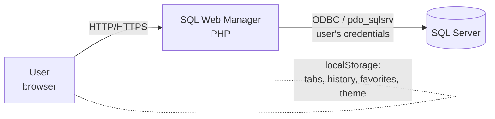
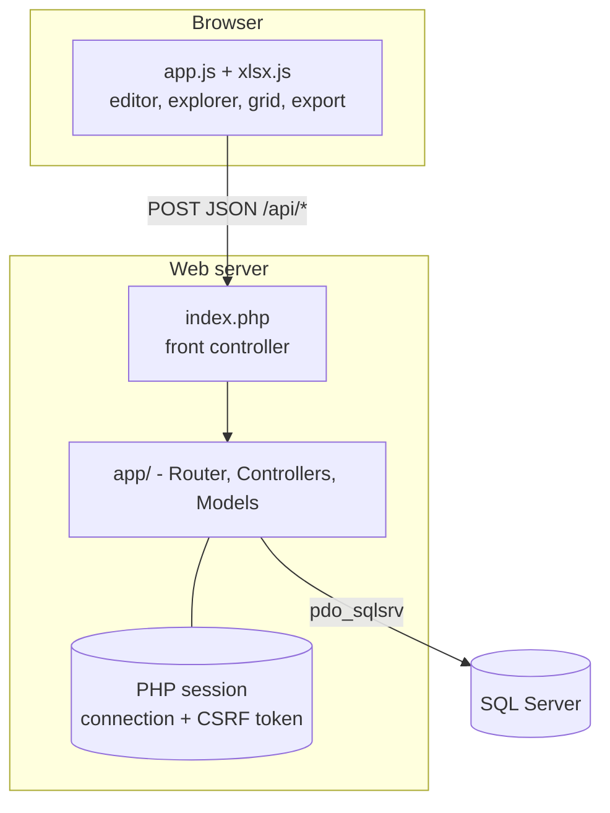
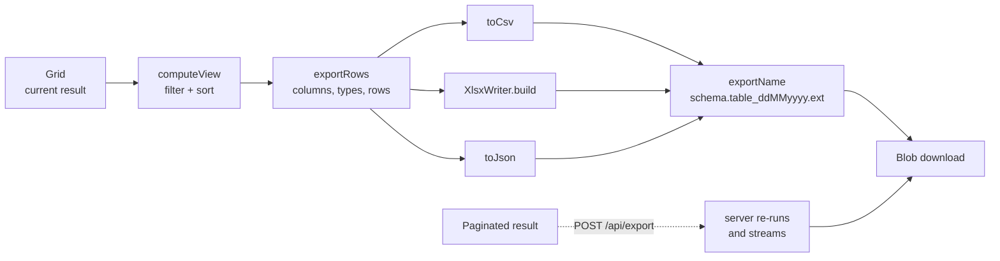

# Architecture

A PHP MVC application with a front controller and no Composer. The front end is plain JavaScript served as static files. The server **stores no business data**: it opens a new SQL Server connection on every request, using the credentials kept in the PHP session.

## Context (C4, level 1)



## Containers (C4, level 2)



## Life of a request

```mermaid
sequenceDiagram
    participant B as Browser
    participant I as index.php
    participant A as Application
    participant R as Router
    participant M as Middleware
    participant C as Controller
    participant D as SQL Server
    B->>I: POST /api/execute (JSON + X-CSRF-Token)
    I->>A: Request::fromGlobals()
    A->>A: Session::start (idle timeout)
    A->>R: dispatch(request)
    R->>M: auth.api → csrf
    M->>C: QueryController::execute
    C->>C: Session::release() (frees the session lock)
    C->>D: QueryExecutor (new connection, USE database, batches; with "page", OFFSET/FETCH)
    D-->>C: result sets and messages
    C-->>B: Response::json + security headers
```

Details:

- `Application::handle` catches any `Throwable`, writes it to `error_log` and returns a generic error (500) without leaking details.
- The `X-Content-Type-Options`, `X-Frame-Options` and `Referrer-Policy` headers are applied to **every** response, including errors.
- Controllers that talk to the database call `Session::release()` right after reading the connection, so long queries do not block other requests from the same user (PHP locks the session file while it is open).

## Folder structure

```
index.php           entry point for hosts without access to public/ (includes public/index.php)
public/             document root: index.php (front controller) and assets/ (css, js)
app/
  bootstrap.php     PSR-4 autoload (App\ → app/) + free functions; returns the Config
  routes.php        routes as data
  Core/             Application (composition root), Router, Container, View, Config
  Http/             Request, Response, Session, Middleware
  Controllers/      Auth, Editor, Explorer, Query — thin, orchestration only
  Models/           Connection, ConnectionFactory, CatalogRepository, ObjectScripter,
                    QueryExecutor, QueryResult; functions.php and ddl.php (pure functions)
  Views/            layout, login, editor (PHP templates)
  Support/          Result and generic functions (pipe, partial, take, pipeline, e)
config/             config.php (defaults) and config.local.php (yours, not versioned)
deploy/             iis-rewrite.xml (web.config snippet)
docker/             apache.conf and php.ini for the image
tests/              run.php (PHP) and xlsx.test.js (Node)
docs/               this documentation
```

## Layers and responsibilities

| Component | Role |
|---|---|
| `Application` | Composition root: wires dependencies in `container()`, starts the session, dispatches and applies headers |
| `Router` | Matches method + exact path (no URL parameters), builds the middleware chain with `pipeline` and calls the controller action. 404 for an unknown path; 405 with `Allow` for the wrong method |
| `Middleware` | `auth.page` (redirects), `auth.api` (401), `guest`, `csrf` |
| `Session` | Wraps `$_SESSION`. Holds the connection (including the password, on the server) and the CSRF token; expires on inactivity |
| `ConnectionFactory` | The **only** place that opens `PDO`. The database is chosen with `USE [database]` and not in the DSN |
| `CatalogRepository` | Queries the catalog (`sys.*`): databases, objects, columns, indexes, foreign keys, space |
| `ObjectScripter` | Generates DDL for tables, views, procedures, functions and databases |
| `QueryExecutor` | Splits on `GO`, runs batch by batch, reads result sets (limit + 1 row to detect truncation) and messages (`PRINT`, affected rows) |
| `QueryResult` | Immutable value with sets, messages, error and time |
| `DataImporter` | Creates a table (if asked) and inserts a batch of imported rows in one transaction, with multi-row parameterized `INSERT`s |

### Pure functions (`app/Models/functions.php`, `ddl.php`)

No I/O and no state: they are covered by tests without needing a database. Main ones: `quote_identifier`, `normalize_server`, `ensure_server_allowed`, `build_dsn`, `split_batches`, `effective_limit`, `type_label`, `column_view`, `database_view`, `safe_cell`, `column_descriptor`, `clean_error_message`, `pdo_error`, `group_indexes`, `group_foreign_keys`, `space_view`, `build_create_table`, `build_create_database`, `mask_sql`, `paginate_sql`, `csv_separator`, `csv_cell`, `csv_line`, `unique_keys`, `safe_filename`, `is_decimal_type`, `format_decimal`, `import_column_type`, `insert_batch_size`, `build_insert_sql`, `build_import_create_table`.

## Front end

Static files with no build step:

- `public/assets/js/app.js`: the whole interface (editor with highlighting and line numbers, tabs, Object Explorer, context menu, grid, export, history and favorites). It talks to the server only through `POST /api/*` (`api()` sends the `X-CSRF-Token`; a 401 response leads to the login).
- `public/assets/js/xlsx.js`: a dependency-free `.xlsx` generator. An `.xlsx` is a ZIP of XML files; the ZIP is written with the *stored* method (no compression), with the CRC-32 computed in JS. It exposes `XlsxWriter.build(columns, types, rows)` (Blob, in the browser) and `buildBytes(...)` (bytes, used in Node by the tests).
- `public/assets/js/import.js`: reads CSV and JSON files for the import dialog (delimiter detection, an RFC 4180 CSV parser, JSON arrays of objects, column type inference). Loaded in Node by `tests/import.test.js`; the dialog itself is in `app.js`.
- `public/assets/js/login.js`: the show/hide password button on the login screen.
- `public/assets/css/app.css`: light/dark theme (`data-theme` attribute).
- Local state (`localStorage`, prefix `sqlwm.`): `tabs`, `activeTab`, `history`, `favorites`, `db`, `autoTop`, `autoTopN`, `theme`, `sidebarWidth`.

## Export flow



- **Fully loaded result** (script with `GO`, `SELECT TOP`, etc.): the export happens in the browser, from the grid (with its filter and sort).
- **Result paginated on the server** (a single `SELECT`): CSV and JSON are downloaded directly from `POST /api/export`, which re-runs the query and streams the output (a `Response` with a `Closure` body); Excel receives the `raw` format and the browser builds the `.xlsx`.

### Server-side pagination

`QueryExecutor::executePage` uses `paginate_sql` (a pure function) to append `OFFSET … FETCH` to the single `SELECT`, after masking comments, strings and parentheses (`mask_sql`) to find the keywords of the main statement. It asks for one extra row to know whether a next page exists (`hasMore`). When the query is not paginable, or the server rejects the paginated version, it returns `null` and `QueryController` falls back to the normal `execute`.

## Import flow

```mermaid
sequenceDiagram
    participant U as User
    participant B as Browser (app.js + import.js)
    participant S as POST /api/import
    participant D as SQL Server
    U->>B: right-click database → Import data…
    B->>S: POST /api/columns (target table)
    U->>B: choose file, destination, mapping
    B->>B: parse CSV/JSON, infer types
    loop batches of up to 1000 rows
        B->>S: columns + rows (+ create on the first batch of a new table)
        S->>D: BEGIN; CREATE TABLE?; INSERT … VALUES …; COMMIT
        D-->>B: inserted n, or error (batch rolled back)
    end
```

The file never reaches the server as a file: the browser parses it and sends rows in batches. Each batch is one transaction; the whole import is not (see [ADR 0005](adr/0005-client-side-import-batches.md)).

## Decisions

See the [ADRs](adr/README.md): [0001 – no Composer and no front-end build](adr/0001-no-composer-no-build.md), [0002 – credentials in the session and a connection per request](adr/0002-credentials-in-session.md), [0003 – client-side export and an in-house `.xlsx`](adr/0003-client-side-xlsx.md), [0004 – server-side pagination with `OFFSET/FETCH`](adr/0004-server-side-pagination.md), [0005 – client-side parsing and batched imports](adr/0005-client-side-import-batches.md).
